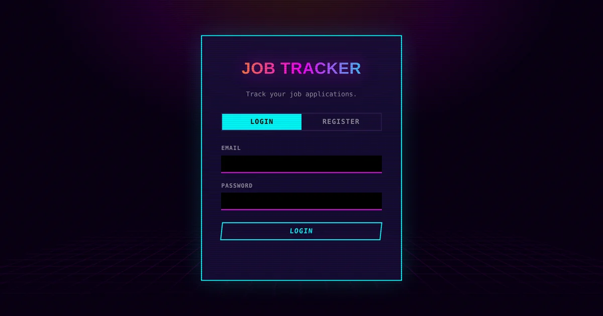

# Job Tracker

A single-file job application tracker with real authentication and database-level data isolation — built with plain HTML/CSS/JS and Supabase (Postgres + Auth + Row Level Security), no framework, no build step.

**[Live demo →](https://job-tracker-69cc42.netlify.app/)**



## Why this exists

A job tracker is a simple CRUD problem on the surface, but it's a good vehicle to demonstrate something that's easy to get wrong: real multi-user data isolation, enforced where it actually matters — the database — not just hidden in the UI. Every row a user creates is tied to their own `auth.uid()` through Postgres Row Level Security policies, so even a broken or malicious client can't read another user's companies or applications. That isolation is verified, not assumed (see *Security* below).

## Features

- **Auth.** Email/password registration and login via Supabase Auth.
- **Companies.** Add, edit, delete, and list the companies you're applying to.
- **Applications.** Each tied to a company, with status (`applied`, `interview`, `offer`, `rejected`, `withdrawn`), date, estimated salary, and notes.
- **Dashboard.** Total applications, response rate, offers received, a breakdown by status, and your top companies by application count.
- **Resumes.** Keep multiple resume versions (e.g. "Frontend", "Full-stack"), structured into optional sections (summary, experience, education, skills, projects, volunteering), each exportable as a standalone, nicely formatted HTML file you can open and save as a PDF or in Word.
- **Offline-aware PWA.** Installable, with a proper fallback screen when there's no connection — the app talks live to Supabase, so there's no real offline mode, and the service worker deliberately avoids caching the app shell itself (see *Design notes*).

## Security

- **Row Level Security on every table**, scoped to `auth.uid()` — a user can only select, insert, update, or delete their own rows. This isn't just an app-level filter; it's enforced by Postgres itself. The tables and all 12 policies are in [`supabase/schema.sql`](supabase/schema.sql).
- **Isolation was tested, not assumed.** A second test account was created specifically to confirm it saw zero companies and zero applications from the first account's data — not just that the queries "looked" scoped correctly. Re-checked on the live project in November 2026: the second account also couldn't rename or delete the first account's company (0 rows affected) or save a row in another user's name (HTTP 403).
- **Users can delete their account and all their data** (header → *Delete account*, confirmed by typing DELETE). The browser can't delete an account with the public key, so this goes through a `security definer` database function, [`supabase/delete_my_account.sql`](supabase/delete_my_account.sql), that only ever acts on the user calling it (`auth.uid()`). The shared demo account is protected from deletion.
- **Strict CSP**, delivered as a real HTTP header via `_headers` on Netlify (not just a `<meta>` tag, which can't carry `frame-ancestors`), plus `X-Frame-Options`, `X-Content-Type-Options`, and a locked-down `Referrer-Policy`.
- **Supabase key in the client is the publishable key** (Supabase's current name for what used to be called the anon key) — it's designed to be public; the real access control is the RLS policies above, not key secrecy.
- **Registration errors are deliberately ambiguous** about whether an email is already registered, to avoid account enumeration.

## Tech stack

- **HTML5 / CSS3 / vanilla JavaScript** — no framework, no bundler, no build step.
- **Supabase** (Postgres + Auth + Row Level Security), loaded from a pinned CDN URL with Subresource Integrity.
- **Netlify** for static hosting and the CSP/security headers.

## Design notes

- **Visual direction:** a vaporwave/outrun theme (cyan/magenta on near-black, skewed buttons, CRT scanline overlay, Orbitron + Share Tech Mono) — a deliberate choice to make a CRUD app memorable rather than generic.
- **Modal UX fix:** modals used to close on any click outside them, which meant selecting text inside a field (a click-and-drag that visually ends over the backdrop) could silently discard unsaved input. Fixed by removing backdrop-close entirely — only explicit Cancel or Save — plus a visual cue (the Save button highlights) when there are unsaved changes.
- **Service worker scope, deliberately narrow:** it exists only to make the app installable and to show a proper offline fallback page — it does **not** cache `index.html`/CSS/JS, because the app is live-data-dependent anyway, and caching the app shell would just produce the classic PWA bug of users stuck on a stale version after a deploy.
- **Stripe integration is demonstration-only**, explicitly in test mode (`buy.stripe.com/test_...`) — it opens a Stripe-hosted Payment Link with no backend or webhook behind it; no real payment is possible, and the app never grants access based on payment.

## Project structure

```
index.html        — the application shell, styles, and markup
app.js             — auth, CRUD, dashboard, resume export, all client-side logic
sw.js              — service worker (install + offline fallback only)
offline.html       — offline fallback page
manifest.json      — PWA manifest
_headers           — Netlify security headers (CSP, X-Frame-Options, ...)
icons/             — PWA icons
```

## License

MIT — see [LICENSE](LICENSE).
